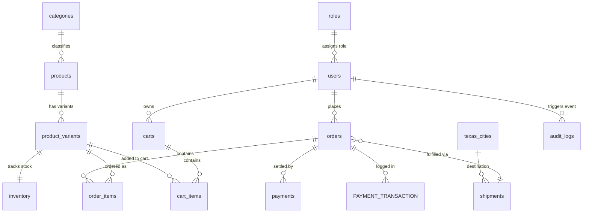

# StockFlow — Smart Retail & Logistics Platform (BrightBuy)

[-blue?style=flat-square&logo=mysql)](https://tidbcloud.com/)
[-green?style=flat-square&logo=flask)](https://flask.palletsprojects.com/)
[](https://vitejs.dev/)
[](https://uom.lk/)
[](https://uom.lk/)

**StockFlow (BrightBuy)** is an enterprise-grade retail and fulfillment platform built for **CS3043 - Database Systems**. The project models an omnichannel retail business with multi-variant product catalogs, ACID-compliant shopping cart and order pipelines, real-time Texas regional logistics tracking, and executive analytics backed by a cloud-hosted TiDB Serverless (MySQL 8.0 compatible) database engine.

---

## 👥 Group 12 — Team Members & Module Ownership

| # | Student Name | Registration No. | Module Ownership | Core Technical Scope |
| :-: | :--- | :---: | :--- | :--- |
| **1** | **HEWABATUWITA V.M.** | `240233G` | **Module 4: Texas Logistics & Fulfillment** | Texas regional hub network, shipment tracking numbers, dispatch pipelines, lead-time estimation, and delivery confirmation triggers. |
| **2** | **NERALAMPITIYA N.P.C.** | `240456R` | **Module 5: Analytics, Reporting & Audit Logs** | Executive KPI dashboards, branch performance breakdowns, sales aggregations, audit trail logging, and printable executive audit dossiers. |
| **3** | **SANJAYA G.Y.S.** | `240594L` | **Module 2: Auth, User Accounts & Shopping Cart** | JWT authentication, role-based authorization (Customer, Manager, System Admin), OTP email verification, and inventory-guarded cart management. |
| **4** | **SURAWEERA K.M.N.S.** | `240637A` | **Module 3: Orders, Checkout & Payments** | Transactional checkout with pessimistic locking (`FOR UPDATE`), duplicate item deduplication, delivery fee computation, and dual-table payment settlement. |
| **5** | **THENUWARA D.U.** | `240658M` | **Module 1: Products, Categories & Inventory** | Multi-attribute product variant catalog, dynamic category hierarchies, stock adjustment thresholds, and variant deletion integrity safeguards. |

---

## 🏛️ System Architecture

```text
+-----------------------------------------------------------------------------------+
|                              CLIENT TIER (React 19 + Vite)                        |
|                                                                                   |
|  +--------------------+  +--------------------+  +--------------------+           |
|  | Catalog & Products |  | Auth & Cart Portal |  | Orders & Checkout  |           |
|  | (CatalogPage.jsx)  |  | (AuthCartPage.jsx) |  | (OrdersPage.jsx)   |           |
|  +--------------------+  +--------------------+  +--------------------+           |
|  +--------------------+  +--------------------+  +--------------------+           |
|  | Texas Logistics    |  | Analytics Dossier  |  | Dashboards & Shell |           |
|  | (LogisticsPage.jsx)|  | (AnalyticsPage.jsx)|  | (Overview, Layout) |           |
|  +--------------------+  +--------------------+  +--------------------+           |
+------------------------------------------+----------------------------------------+
                                           |  JSON over HTTP (REST API)
                                           v  Axios Client (Bearer JWT Auth)
+-----------------------------------------------------------------------------------+
|                             API GATEWAY TIER (Flask 3.x)                          |
|                                                                                   |
|  app.py (CORS, JWT Manager, Central Error Handlers, SSL Connection Pool)          |
|                                                                                   |
|  [ /api/catalog ]       [ /api/auth_cart ]      [ /api/orders ]                   |
|  catalog.py             auth_cart.py            orders.py                         |
|  - Products & Variants  - Login / Register      - Pessimistic Checkout Locking    |
|  - Stock Thresholds     - User Cart Isolation   - Order Status Machine            |
|  - Category Taxonomies  - OTP Verification      - Payment Gateway Simulation      |
|                                                                                   |
|  [ /api/logistics ]     [ /api/analytics ]      [ email_service.py ]              |
|  logistics.py           analytics.py            - Brevo SMTP Relay                |
|  - Hub Distance Matrix  - SQL View Aggregations - Receipts & Tracking Emails      |
|  - Shipment Transitions - Audit Log Triggers    - OTP Fallback Dispatcher         |
+------------------------------------------+----------------------------------------+
                                           |  TLS 1.2/1.3 Encrypted Pool
                                           v  mysql-connector-python + certifi
+-----------------------------------------------------------------------------------+
|                      DATABASE TIER (TiDB Serverless / MySQL 8.0)                  |
|                                                                                   |
|  +--------------------+  +--------------------+  +--------------------+           |
|  |  Catalog Schema    |  |    Auth Schema     |  |    Cart Schema     |           |
|  |  - categories      |  |  - roles           |  |  - carts           |           |
|  |  - products        |  |  - users           |  |  - cart_items      |           |
|  |  - product_variants|  |                    |  |                    |           |
|  |  - inventory       |  |                    |  |                    |           |
|  +--------------------+  +--------------------+  +--------------------+           |
|  +--------------------+  +--------------------+  +--------------------+           |
|  |   Orders Schema    |  |  Logistics Schema  |  |  Auditing & Intel  |           |
|  |  - orders          |  |  - texas_cities    |  |  - audit_logs      |           |
|  |  - order_items     |  |  - shipments       |  |  - SQL Views       |           |
|  |  - payments        |  |                    |  |  - Triggers & SPs  |           |
|  |  - PAYMENT_TRANS.  |  |                    |  |                    |           |
|  +--------------------+  +--------------------+  +--------------------+           |
+-----------------------------------------------------------------------------------+
```

---

## 📁 Repository Structure

```text
StockFlow/
├── backend/
│   ├── app.py                      # Flask application factory, JWT configuration, blueprint routing
│   ├── db.py                       # TiDB Cloud connection pool with SSL/TLS verification
│   ├── email_service.py            # Brevo SMTP integration with stdout dev fallback
│   ├── otp_service.py              # OTP token verification service
│   ├── requirements.txt            # Python dependencies
│   ├── test_catalog.py             # Catalog module unit checks
│   ├── test_db.py                  # Database connection & schema diagnostic tool
│   ├── test_logistics.py           # Logistics pipeline tests
│   ├── routes/                     # Modular API Blueprints (1 per team member)
│   │   ├── catalog.py              # [Thenuwara] Module 1: Catalog, products, variants, inventory
│   │   ├── auth_cart.py            # [Sanjaya]   Module 2: Authentication, accounts, user shopping carts
│   │   ├── orders.py               # [Suraweera] Module 3: Orders, checkout pipeline, payment synchronization
│   │   ├── logistics.py            # [Hewabatuwita] Module 4: Texas hubs, lead times, shipments
│   │   └── analytics.py            # [Neralampitiya] Module 5: Metrics, reports, and audit logging
│   └── sql/
│       ├── 04_logistics.sql        # Logistics schema, Texas cities, seed hubs
│       └── 05_analytics.sql        # Analytics views, stored procedures, and audit triggers
├── frontend/
│   ├── index.html                  # HTML5 entrypoint
│   ├── package.json                # Frontend dependencies & build scripts
│   ├── vite.config.js              # Vite server & build configuration
│   └── src/
│       ├── main.jsx                # Application DOM bootstrap
│       ├── App.jsx                 # Client-side router & role navigation
│       ├── index.css               # Design tokens, color system, and layout styles
│       ├── api/
│       │   └── client.js           # Axios client configured with JWT interceptors
│       ├── assets/                 # High-resolution product images and brand logos
│       ├── components/
│       │   ├── DashboardLayout.jsx # App navbar, role switcher, announcement bar, cart badge
│       │   ├── ProtectedRoute.jsx  # Role-based route guard
│       │   ├── Icons.jsx           # SVG iconography
│       │   └── orders/             # Sub-views for order lifecycle
│       │       ├── CheckoutSplitView.jsx   # Two-column checkout & payment simulator
│       │       ├── FulfillmentQueueView.jsx # Staff order dispatch & tracking search
│       │       ├── OrderHistoryView.jsx    # Customer order log with item receipts
│       │       └── OrderLookupView.jsx     # Order tracker and item invoice view
│       └── pages/
│           ├── OverviewPage.jsx    # Storefront landing page & featured deal cards
│           ├── CatalogPage.jsx     # [Thenuwara] Product catalog, variant filter & inventory controls
│           ├── AuthCartPage.jsx    # [Sanjaya] Shopping cart, isolated user storage, stock caps
│           ├── OrdersPage.jsx      # [Suraweera] Checkout, fulfillment queue & order tracking
│           ├── LogisticsPage.jsx   # [Hewabatuwita] Hub map, lead-time calculator, live tracking
│           ├── AnalyticsPage.jsx   # [Neralampitiya] Sales reports, branch audits, dynamic dossiers
│           ├── Login.jsx           # Unified user login with role-based routing
│           ├── RegisterPage.jsx    # Customer account creation with OTP verification
│           ├── CustomerDashboard.jsx # Customer order summary and account settings
│           ├── ManagerDashboard.jsx  # Store manager operational portal
│           └── SystemAdministrator.jsx # System administrator management console
├── tests/
│   ├── test_orders.py              # 26 automated tests for checkout locking & order lifecycle
│   └── test_analytics_e2e.py       # 12 automated tests for analytics views & audit triggers
├── stockflow_dump.sql              # Ground-truth database dump (DDL, triggers, views, seed data)
└── README.md
```

---

## 🔍 Module Deep-Dive & Key Engineering Highlights

### Module 1: Catalog & Inventory Management
- **Owner:** THENUWARA D.U. (`240658M`)
- **Key Files:** `backend/routes/catalog.py`, `frontend/src/pages/CatalogPage.jsx`
- **Engineering Highlights:**
  - Dynamic grouping of multi-attribute product variants (Color, Storage, Style) under parent products.
  - Read-only stock reservation check (`/cart/reserve`) preventing premature double-deductions before checkout.
  - Decoupled inventory stock adjustments (`adjust` delta / `stock_quantity`) from safety thresholds (`low_stock_threshold`).
  - Strict foreign key safeguard blocking deletion of variants referenced in active orders or shopping carts.
  - Non-manager query protection filtering out soft-deleted products (`is_active = 0`).

### Module 2: Authentication, User Accounts & Shopping Cart
- **Owner:** SANJAYA G.Y.S. (`240594L`)
- **Key Files:** `backend/routes/auth_cart.py`, `backend/email_service.py`, `frontend/src/pages/AuthCartPage.jsx`
- **Engineering Highlights:**
  - JWT token minting with claims (`user_id`, `role_id`, `email`, `username`) and role-based access decorators.
  - Prevention of inventory inflation bug by eliminating false stock restorations on cart item updates and deletions.
  - Multi-tenant client isolation storing carts per user (`cart_${uid}`) to prevent cross-account leakage.
  - Product active status check (`is_active = 1`) and available stock validation on all cart additions.
  - Fallback console logging for registration and password reset OTPs when external SMTP relays are unreachable.

### Module 3: Orders, Checkout Pipeline & Payment Gateway
- **Owner:** SURAWEERA K.M.N.S. (`240637A`)
- **Key Files:** `backend/routes/orders.py`, `frontend/src/components/orders/CheckoutSplitView.jsx`
- **Engineering Highlights:**
  - Pessimistic concurrency control (`SELECT ... FOR UPDATE`) during checkout to prevent overselling on flash sales.
  - Client payload deduplication merging identical variant IDs into single aggregate quantities.
  - State machine lifecycle governing valid order transitions (`PENDING` -> `CONFIRMED` -> `SHIPPED` -> `DELIVERED` or `CANCELLED`).
  - Dual-write payment synchronization writing to both `payments` and legacy `PAYMENT_TRANSACTION` tables.
  - Server-side fee verification preventing client tampering of online service fees ($0.50) and shipping costs.

### Module 4: Texas Regional Logistics & Warehousing
- **Owner:** HEWABATUWITA V.M. (`240233G`)
- **Key Files:** `backend/routes/logistics.py`, `backend/sql/04_logistics.sql`, `frontend/src/pages/LogisticsPage.jsx`
- **Engineering Highlights:**
  - Texas distribution network model linking destination cities to fulfillment hubs (Austin, Dallas, Houston, San Antonio, Fort Worth, etc.).
  - Dynamic delivery lead-time calculation incorporating regional distance matrix and backorder delay penalties.
  - Shipment status transition pipeline (`PENDING` -> `DISPATCHED` -> `IN_TRANSIT` -> `DELIVERED`).
  - Automated status synchronization updating linked order status to `DELIVERED` and settling COD payments upon doorstep handover.
  - Automated customer dispatch and delivery notification emails with tracking numbers.

### Module 5: Analytics, Executive Reports & Auditing
- **Owner:** NERALAMPITIYA N.P.C. (`240456R`)
- **Key Files:** `backend/routes/analytics.py`, `backend/sql/05_analytics.sql`, `frontend/src/pages/AnalyticsPage.jsx`
- **Engineering Highlights:**
  - Executive sales dashboard aggregating revenue, settlement ratios, and unit velocity across product categories.
  - Dynamic regional hub breakdown derived directly from live database records (eliminating static dummy branch data).
  - Audit log table (`audit_logs`) tracking sensitive administrative events, order transitions, and payment settlements.
  - Database views and stored procedures optimizing multi-table analytical joins.
  - Client-side printable PDF and executive audit dossier generation with zero mock data.

---

## 🗄️ Relational Database Schema (TiDB / MySQL 8.0)

The relational engine operates with 14 interconnected tables and transactional foreign key constraints:



### Table Summary
- **`roles`**: System permission tiers (`Customer`, `Manager`, `System Administrator`).
- **`users`**: Account profiles, hashed credentials, contact information, and role assignments.
- **`categories`**: Product catalog taxonomies with URL slugs.
- **`products`**: Parent items with titles, base descriptions, base prices, active flags, and image URLs.
- **`product_variants`**: Specific SKUs with attribute key/value pairs (e.g., Color = Space Gray) and price overrides.
- **`inventory`**: Real-time available quantities and configurable low-stock alert thresholds.
- **`carts` & `cart_items`**: Persistent shopping carts per authenticated customer.
- **`orders`**: Master purchase records storing statuses, pricing totals, and delivery cities.
- **`order_items`**: Point-in-time purchased variant snapshots, captured unit prices, and quantities.
- **`payments` & `PAYMENT_TRANSACTION`**: Financial transaction receipts, methods (`CARD`, `COD`), and settlement states.
- **`texas_cities`**: Texas logistics nodes, fulfillment hub assignments, and base lead times.
- **`shipments`**: Unique tracking numbers, carrier notes, dispatch timestamps, and estimated arrivals.
- **`audit_logs`**: Immutable event trail capturing operational actions, client IPs, and timestamps.

---

## 🐳 Quick Start with Docker (Recommended)

You can build and launch both the Flask backend and React frontend with a single command:

```bash
docker compose up --build
```

- **Frontend (Storefront & Portals):** [`http://localhost:5173`](http://localhost:5173)
- **Backend API & Health Check:** [`http://localhost:5000/api/health`](http://localhost:5000/api/health)

To run the containers in the background:
```bash
docker compose up -d --build
```

To stop all services:
```bash
docker compose down
```

---

## ⚙️ Manual Local Development Setup

### 1. Prerequisites
- **Python 3.10+** (Python 3.12 recommended)
- **Node.js 18+** & `npm`
- **Git**
- Active **TiDB Serverless** or MySQL 8.0 instance

---

### 2. Backend Installation

1. Navigate to the project root and activate a Python virtual environment:
   ```bash
   # Linux / macOS
   python3 -m venv .venv
   source .venv/bin/activate

   # Windows (PowerShell)
   python -m venv .venv
   .\.venv\Scripts\Activate.ps1
   ```

2. Install backend dependencies:
   ```bash
   pip install -r backend/requirements.txt
   ```

3. Configure environment variables:
   - Create `backend/.env` with your TiDB Cloud credentials:
     ```env
     DB_HOST=gateway01.us-east-1.prod.aws.tidbcloud.com
     DB_PORT=4000
     DB_USER=your_tidb_user.root
     DB_PASSWORD=your_tidb_password
     DB_NAME=StockFlow
     DB_USE_SSL=true
     SECRET_KEY=your_secure_jwt_secret_key_at_least_32_chars_long
     CORS_ORIGIN=http://localhost:5173
     
     # Optional: Brevo SMTP credentials for email delivery
     SMTP_SERVER=smtp-relay.brevo.com
     SMTP_PORT=587
     SMTP_USERNAME=your_brevo_smtp_login
     SMTP_PASSWORD=your_brevo_smtp_key
     SENDER_EMAIL=noreply@brightbuy.com
     SENDER_NAME="BrightBuy Ecommerce"
     ```

4. Verify database connectivity:
   ```bash
   python backend/test_db.py
   ```

5. Launch the Flask API server:
   ```bash
   python backend/app.py
   ```
   - API runs at: **`http://localhost:5000`**
   - Health check: **`http://localhost:5000/api/health`**

---

### 3. Frontend Installation

1. Open a new terminal window and navigate to `frontend/`:
   ```bash
   cd frontend
   npm install
   ```

2. Run the Vite development server:
   ```bash
   npm run dev
   ```
   - Frontend runs at: **`http://localhost:5173`**

3. Verify production build:
   ```bash
   npm run build
   ```

---

## 🧪 Automated Test Suite

The project includes unit and integration tests covering the most critical business logic (concurrency locking, deduplication, state transitions, and analytical views):

```bash
# Run all order & checkout pipeline tests (26 test cases)
python -m unittest tests/test_orders.py

# Run all analytics & audit trigger tests (12 test cases)
python -m unittest tests/test_analytics_e2e.py
```

All 38 test cases execute against the live schema and validate strict transactional integrity.

---

## 🔐 Default Demo Accounts

For evaluation purposes, the database is pre-seeded with accounts for each role:

| Role | Email | Password | Primary Interface |
| :--- | :--- | :--- | :--- |
| **Customer** | `sarah.j@example.com` | `password123` | Storefront, Catalog, Cart, Customer Dashboard |
| **Store Manager** | `manager@brightbuy.com` | `manager123` | Inventory Adjustments, Variant Management, Dispatch Pipeline |
| **System Administrator** | `admin@brightbuy.com` | `admin123` | Executive Analytics Dossier, Audit Logs, Staff Controls |

---

## 📜 Academic Integrity & Course Information
- **Course:** CS3043 - Database Systems
- **Institution:** Department of Computer Science & Engineering, University of Moratuwa
- **Group:** Group 12
- **Academic Year:** Semester 3, 2026